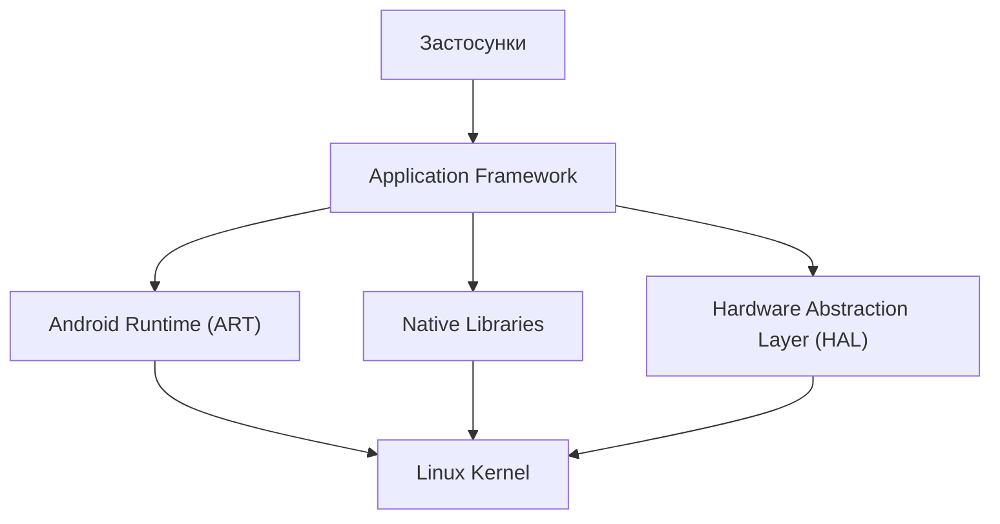
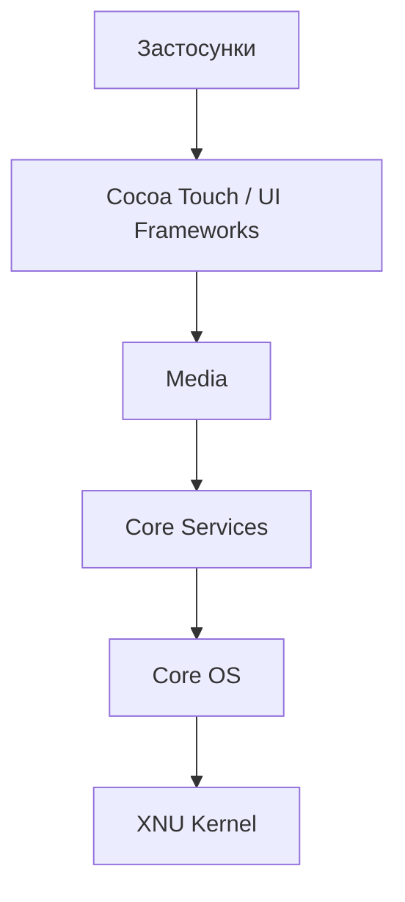
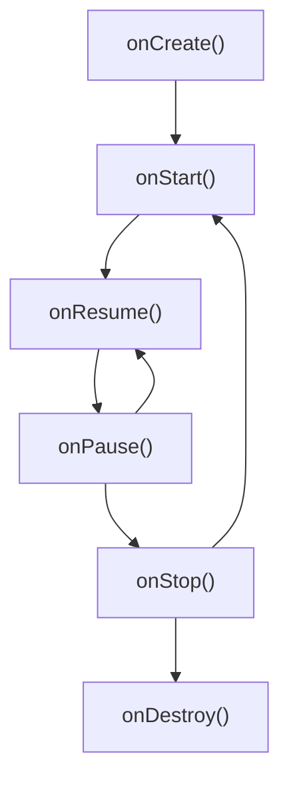

Практична робота №1

Загальний огляд мобільних платформ

Дисципліна: Програмування для мобільних платформ
Тема: Архітектурне порівняння Android та iOS
Варіант: 2

⸻

1. Мета роботи

Дослідити та порівняти архітектури мобільних платформ Android та iOS, визначити відповідність між їхніми архітектурними рівнями, розглянути життєвий цикл екрана та проаналізувати практичні наслідки відмінностей для розробників.

2. Вступ

Android та iOS є двома основними платформами для розробки мобільних застосунків. Вони мають різні архітектурні підходи, інструменти розробки та механізми керування життєвим циклом екранів.

Android використовує багаторівневу архітектуру на основі ядра Linux, системних бібліотек, Android Runtime та Application Framework. iOS побудована на основі Darwin/XNU та містить рівні системних сервісів, медіатехнологій, фреймворків інтерфейсу й системних API.

Розуміння цих відмінностей допомагає розробникам створювати стабільні, продуктивні та зручні мобільні застосунки.

3. Порівняння архітектур Android та iOS

3.1. Архітектура Android

Архітектура Android складається з кількох рівнів:

1. Linux Kernel — керує пам’яттю, процесами, драйверами пристроїв і безпекою.
2. Hardware Abstraction Layer (HAL) — забезпечує взаємодію між апаратним забезпеченням і системними компонентами.
3. Native Libraries та Android Runtime (ART) — містять системні бібліотеки й середовище виконання застосунків.
4. Application Framework — надає API для роботи з Activity, сервісами, сповіщеннями та іншими системними можливостями.
5. Applications — системні та встановлені користувачем застосунки.

3.2. Архітектура iOS

Архітектура iOS також складається з декількох рівнів:

1. Core OS — базові системні компоненти, ядро XNU, керування процесами, пам’яттю та безпекою.
2. Core Services — основні системні служби, робота з даними, мережею та геолокацією.
3. Media — технології для графіки, анімації, аудіо та відео.
4. Cocoa Touch — традиційна назва верхнього рівня фреймворків для інтерфейсу й взаємодії з користувачем. У сучасній розробці також широко використовується SwiftUI.

3.3. Порівняльна таблиця

Критерій	Android	iOS
Ядро операційної системи	Linux Kernel	XNU (Darwin)
Робота з обладнанням	HAL та драйвери	Системні компоненти та драйвери
Середовище виконання	Android Runtime (ART)	Нативне виконання коду та системні механізми Swift/Objective-C
Системні API	Android Framework	Apple SDK та системні фреймворки
Створення інтерфейсу	Jetpack Compose, Views	SwiftUI, UIKit
Основні мови розробки	Kotlin, Java	Swift, Objective-C
Середовище розробки	Android Studio	Xcode
Поширення застосунків	Google Play та інші дозволені способи	App Store та інші доступні в конкретному регіоні способи поширення

3.4. Відповідність архітектурних рівнів

Android	Приблизний відповідник в iOS
Linux Kernel	XNU Kernel
HAL та системні компоненти	Апаратно-залежні системні компоненти
Native Libraries та ART	Системні бібліотеки й середовище виконання
Application Framework	Apple SDK та системні фреймворки
Applications	iOS-застосунки

Важливо зазначити, що архітектури Android та iOS не є повністю ідентичними. Наведена відповідність є функціональним зіставленням, а не прямою відповідністю кожного компонента.

4. Діаграми архітектури

4.1. Архітектура Android

4.2. Архітектура iOS

5. Життєвий цикл екрана

5.1. Android

В Android життєвий цикл екрана часто розглядають на прикладі Activity. Основні методи життєвого циклу:

* onCreate() — створення Activity та початкова ініціалізація.
* onStart() — Activity стає видимою.
* onResume() — Activity переходить у стан взаємодії з користувачем.
* onPause() — Activity втрачає активний фокус.
* onStop() — Activity більше не видима.
* onDestroy() — Activity знищується, якщо система або застосунок завершують її життєвий цикл.

Схема спрощеного життєвого циклу:

5.2. iOS

В iOS життєвий цикл залежить від типу інтерфейсу та архітектури застосунку. Для традиційного UIKit важливими є стани UIViewController:

* viewDidLoad() — представлення завантажене в память.
* viewWillAppear() — представлення готується до появи на екрані.
* viewDidAppear() — представлення вже відображається.
* viewWillDisappear() — представлення готується до зникнення.
* viewDidDisappear() — представлення більше не відображається.

Для застосунку загалом UIKit також використовує стани життєвого циклу сцени, наприклад активний стан та перехід у фон.

6. Порівняння життєвих циклів

| Критерій | Android | iOS |
|---|---|---|
| Основна сутність інтерфейсу | Activity | UIViewController |
| Початкова ініціалізація | onCreate() | viewDidLoad() |
| Поява на екрані | onStart(), onResume() | viewWillAppear(), viewDidAppear() |
| Зникнення з екрана | onPause(), onStop() | viewWillDisappear(), viewDidDisappear() |
| Керування станом застосунку | Життєвий цикл компонентів і процесу | Життєвий цикл сцен і застосунку |
| Типова помилка | Не зберегти стан під час пересоздання Activity | Виконувати оновлення інтерфейсу не в тому методі життєвого циклу |

Методи Android та iOS не є повністю еквівалентними. Таблиця показує приблизну функціональну відповідність.

7. Помилки через ігнорування життєвого циклу

* Втрата стану інтерфейсу. Наприклад, користувач повертається до екрана й виявляє, що введені дані зникли.
* Витік пам’яті або зайві ресурси. Таймери, слухачі подій чи інші ресурси продовжують працювати після того, як екран більше не потрібен.
* Зайві запити та некоректне оновлення інтерфейсу. Після повернення до екрана дані можуть завантажуватися повторно або відображатися неактуальними.

8. Практичні наслідки для розробника

Відмінності між Android та iOS впливають на щоденну роботу розробника.

1. Різні інструменти розробки. Для Android зазвичай використовують Android Studio, Kotlin і Jetpack Compose. Для iOS — Xcode, Swift і SwiftUI. Тому розробнику потрібно опанувати різні інструменти та мови програмування.
2. Різні підходи до керування життєвим циклом. В Android необхідно правильно обробляти життєвий цикл Activity та збереження стану під час зміни конфігурації. В iOS потрібно враховувати життєвий цикл UIViewController і стани сцен. Це впливає на збереження даних, виконання запитів і роботу інтерфейсу.
3. Різні підходи до тестування. Android працює на пристроях багатьох виробників із різними характеристиками. В iOS апаратна та програмна екосистема більш контрольована. Тому для Android особливо важливо перевіряти сумісність із різними пристроями та версіями системи.

## 9. Висновок

Android та iOS мають різні архітектурні компоненти й механізми керування життєвим циклом екранів, але обидві платформи забезпечують розробникам інструменти для створення сучасних мобільних застосунків.

Для розробки під Android необхідно розуміти роботу Activity, Android Runtime та Application Framework. Для iOS важливо знати принципи роботи UIKit або SwiftUI, системних фреймворків і життєвого циклу сцен.

Отже, розробник повинен враховувати особливості кожної платформи, правильно керувати станом інтерфейсу, звільняти ресурси та тестувати застосунок у різних умовах.

10. Джерела

* Android Developers. Application fundamentals. https://developer.android.com/guide/components/fundamentals
* Android Developers. Activity lifecycle. https://developer.android.com/guide/components/activities/activity-lifecycle
* Android Open Source Project. Platform architecture. https://source.android.com/docs/core/architecture
* Apple Developer. App architecture. https://developer.apple.com/documentation/technologyoverviews/app-architecture
* Apple Developer. UIViewController. https://developer.apple.com/documentation/uikit/uiviewcontroller
* Apple Developer. SwiftUI. https://developer.apple.com/xcode/swiftui/

Дата звернення до джерел: 22.10.2026.
